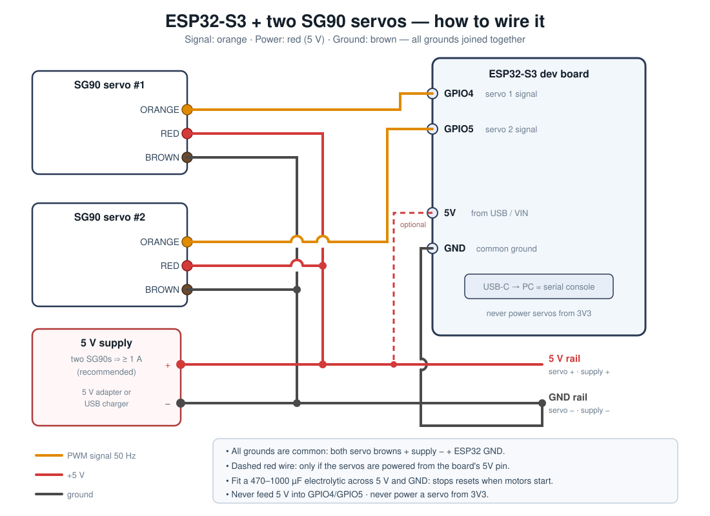

# Wiring — two servos to an ESP32-S3

Two servo types are supported and share the same 3 wires, so the *connection* is
identical. **The power supply is not.** Jump to
[§9 DS3225MG (25 kg)](#9-dsservo-ds3225mg-25-kg-digital-servo) if you are using
the big metal-gear servos.

## 1. The servo's 3 wires

Both servo families use the same 3-pin female connector and the same signalling,
so one wiring diagram covers both:

| Function | SG90 / micro (yours) | DS3225MG (25 kg) |
|---|---|---|
| Ground | **Brown** | **Brown / black** |
| V+ | **Red** | **Red** (middle pin) |
| PWM signal | **Orange** | **Orange / white** |

The colours are usually printed on the servo's PCB or you can read them off the
connector: V+ is always the **middle** pin, ground is always the pin nearest the
case edge. **Never trust colour alone — check the middle pin is the positive one.**

> ⚠️ **Reversed-polarity myth check:** plugging the signal wire to a GPIO is
> harmless. Swapping **power and ground** on a DS-class servo will destroy it
> instantly (no reverse-polarity protection). Verify the connector orientation
> before you apply power.

## 2. Default pins used by this firmware

| Signal | ESP32-S3 pin | Firmware constant |
|---|---|---|
| Servo 1 PWM | **GPIO4** | `servo.c` → `s_servos[0].gpio` |
| Servo 2 PWM | **GPIO5** | `servo.c` → `s_servos[1].gpio` |
| Ground | **GND** | — |
| Servo power | **5 V** (see §4) | — |

Both pins are free on every common S3 dev board, output-capable, and clear of
the flash/PSRAM pins (26–32), the USB pins (19/20), UART0 (43/44) and the
strapping pins (0, 3, 45, 46). If you prefer other pins, change those two lines
and rebuild — any output-capable GPIO works.

## 3. Connection diagram



*(Same image as PNG: [docs/wiring.png](docs/wiring.png) — view it in the
workspace preview or any image viewer.)*

Plain-text version of the same thing:

```
servo 1 orange   ->  ESP32 GPIO4        servo 2 orange  ->  ESP32 GPIO5
servo 1 red      ->  5 V rail           servo 2 red     ->  5 V rail
servo 1 brown    ->  GND rail           servo 2 brown   ->  GND rail
5 V supply  +    ->  5 V rail   (optional: board 5V pin instead)
5 V supply  -    ->  GND rail
ESP32 GND        ->  GND rail   (always; this is the common ground)
```

## 4. Power — read this before you connect the red wires

The vendor's own numbers for this servo: about **10 mA idle, 100–250 mA while
moving, up to 360 mA stalled**. Two of them can pull **~0.5–0.7 A** on inrush.

| Situation | What to do |
|---|---|
| **Breadboard / both servos moving** (recommended) | Use an external **5 V supply rated ≥ 1 A**. Connect its **GND to the ESP32 GND** — this common ground is mandatory, the PWM signal has no reference without it. |
| **Single servo, light load, test only** | You *can* power one servo from the board's `5V` pin when the board is USB-powered. It often works, but brown-outs/resets are common — this is exactly the case where the vendor suggests the big capacitor. |
| **Never** | Do not power servos from `3V3`. Do not feed 5 V into a signal pin. Do not leave the servo grounds floating. |

Add a **470–1000 µF electrolytic** across 5 V and GND near the servos (mind the
polarity: the striped leg is negative). That one part removes most "the ESP32
reboots when the servo moves" problems.

> **If your board has a 5 V rail that is only alive on USB** (very common):
> powering from a USB charger is fine for a bench test, but powering servos from
> a battery through `VIN` while USB is also plugged in is a good way to back-feed
> the regulator. Use one power source at a time, or a proper 5 V supply as above.

## 5. Before you power on — checklist

- [ ] Servo red wires go to **5 V**, not 3V3.
- [ ] All grounds tied together (ESP32 GND ↔ 5 V supply GND ↔ servo browns).
- [ ] Signal wires land on **GPIO4** and **GPIO5** (or whatever you set in `servo.c`).
- [ ] Capacitor polarity correct, if fitted.
- [ ] Servo horns can turn freely and nothing blocks the arm through its travel.

## 6. Bench-test without the ESP32 (5-minute sanity check)

Before blaming the firmware, prove each servo works. With a separate 5 V supply:

1. Connect brown to supply **−**, red to supply **+**.
2. Touch a wire from the supply **+** to the **orange** wire for a moment — the
   horn should jerk to one end. Touch it to **−** and it should swing to the other
   end. *(This is a crude full-swing test: don't hold it there long, and don't do
   it repeatedly. It's just proof the motor and gears are alive.)*
3. If the servo is silent, it's a wiring/power problem, not this firmware.

## 7. If a servo buzzes or jitters at the ends

Every SG90's usable range is a bit narrower than the advertised 180° (the vendor
says so explicitly: driving past the mechanical stop stalls the motor and can
strip the nylon gears). The firmware therefore defaults to a slightly reduced
travel, centred on 1.5 ms:

* `SERVO_MIN_PULSE_US 500` … `SERVO_MAX_PULSE_US 2500` in `main/servo.h`
  (the vendor's fuller range would be 1000 … 2000 µs; that is what the
  datasheet literally specifies, but real units often complain at the extremes).

**To calibrate a servo properly:** run `sweep servo1` and listen. If it buzzes or
grinds near an end, narrow the range, e.g.:

```c
#define SERVO_MIN_PULSE_US  700    /* was 500 */
#define SERVO_MAX_PULSE_US  2300   /* was 2500 */
```

Rebuild and re-flash. Repeat until it runs quietly through the whole sweep —
that is the mechanical limit of *your* unit.

## 8. Pin conflicts to avoid (ESP32-S3)

| Pins | Why to avoid |
|---|---|
| GPIO26–32 | SPI flash / PSRAM on most modules |
| GPIO19, GPIO20 | native USB D−/D+ (this firmware's console port) |
| GPIO43, GPIO44 | UART0 TX/RX (the `build-uart` console) |
| GPIO0, 3, 45, 46 | strapping pins — changing them at boot can stop the chip booting |
| GPIO33–37 | not available on octal-PSRAM modules |

---

## 9. DSSERVO DS3225MG (25 kg) digital servo

Applies to the Amazon 4-pack (`B09SB8RMTT`) and any DS3225 / DS3218 / MG996R-class
standard servo.

### 9.1 What changes vs the SG90

| | SG90 (micro) | **DS3225MG (25 kg)** |
|---|---|---|
| Size | 23 × 12 × 29 mm | **40 × 20 × 40.5 mm** |
| Weight | 9 g | **60–67 g** |
| Torque | 1.8 kg·cm | **21 kg·cm @5 V / 24.5–28 @6.8 V** |
| Idle current | 10 mA | **4–5 mA** |
| Working current | 100–250 mA | **≈1–2 A each** |
| **Stall current** | 0.36 A | **2.1 A @5 V · 2.9 A @6.8 V** |
| Connector | 3-pin, 2.54 mm | same (may be a 3-pin JR/"Futaba" housing) |
| **Logic level** | 3.3 V OK | **3.3 V OK — it's an industry-standard input** |
| Pulse range | 1.0–2.0 ms (0–180°) | **500–2500 µs full travel**, neutral 1500 µs |

Because the DS3225's pulse range is 500–2500 µs and neutral is 1500 µs, **the
firmware's default pulse settings already match it exactly** — only the angle
bookkeeping changes (see 9.2).

### 9.2 180° vs 270° versions — pick the right build

The same servo is sold in **180°** and **270°** variants, and *both* use a
500–2500 µs pulse range. That means:

* **180° version** → `SERVO_TRAVEL_DEG=180` → 500 µs = 0°, 1500 µs = 90°, 2500 µs = 180°.
* **270° version** → `SERVO_TRAVEL_DEG=270` → 500 µs = 0°, 1500 µs = **135°**, 2500 µs = 270°.

If you tell a 270° servo it only has 180° of travel, it still moves — it just
stops 90° short at the top end. The listing title says **180 Degree**; if your
servos sweep further than 180° in the test, use the 270 build. The `sweep`
command tells you immediately: it should travel the full mechanical range without
buzzing at either end.

**Prebuilt images** (already in `prebuilt/`):

```bash
./flash.sh /dev/ttyUSB0 ds3225-180        # 180 deg version, USB console
./flash.sh /dev/ttyUSB0 ds3225-180-uart   # 180 deg version, UART console
./flash.sh /dev/ttyUSB0 ds3225-270        # 270 deg version, USB console
./flash.sh /dev/ttyUSB0 ds3225-270-uart   # 270 deg version, UART console
```

From source, same thing without editing any file:

```bash
make build SERVO_TYPE=2 SERVO_TRAVEL_DEG=180      # or 270
make flash PORT=/dev/ttyACM0
```

The boot banner prints what is compiled in, e.g.
`servo type: DS3225MG (25 kg digital), 180 deg, 500-2500 us`.

### 9.3 Power — this is the part that matters

Per-servo stall current is **2.1 A @ 5 V / 2.9 A @ 6.8 V**. Two of them can pull
**≈4–6 A**. A dev-board `5V` pin or a USB port (0.5–0.9 A) cannot do it, and the
failure mode is ugly: the ESP32 browns out and reboots mid-command, or the servo
hunts and buzzes because its supply sags.

| Supply | Verdict for 2× DS3225 |
|---|---|
| ESP32 board `5V` pin from USB (≈0.5 A) | **No.** Brown-outs, likely reboot loop. |
| USB 3.0 port (≈0.9 A) | **No.** |
| 5 V 3 A adapter | Marginal — fine for gentle, unloaded movement only. |
| **5 V 5 A adapter** | Works for light loads; add ≥ 2200 µF at the servos. |
| **5 V ≥ 6 A supply (recommended)** | Comfortable for two, including stall moments. |

Practical rules:

1. **Separate supply for the servos.** Only the ground is shared with the ESP32.
   Run a **thick** ground wire (20 AWG or better) back to the supply — servo
   return current on a thin dupont lead causes exactly the "random reboot" bugs
   people blame on firmware.
2. **Big bulk capacitance** near the servos: **2200 µF minimum for two DS3225**
   (vs 470–1000 µF for SG90s). It supplies the inrush spike the adapter can't.
3. **Consider a 6.0–6.8 V supply** rather than 5 V: more torque and speed, and
   still inside the 4.8–6.8 V rating. **Do not exceed 6.8 V** — no 7.4 V/2S LiPo
   directly.
4. **Never** power them from the ESP32's 3V3 rail.
5. Servos are electrically noisy — if you see random resets even with a good
   supply, add a **ferrite bead / 100 nF** across the servo's supply pins.

### 9.4 Mechanical notes

* Standard-size **25T spline** horns are included; the spline is 5.9 mm.
* Mounting: 4 screws through the flanges; the case is 40 × 20 mm with the standard
  49.5 mm hole spacing — the same footprint as most standard servos.
* **Do not drive the servo against a hard stop** to "hold" a position — that is a
  stalled motor at 2–3 A and it will cook. Use the mechanical linkage so the load
  is only where you need it.
* Metal gears are strong but **not unbreakable**, and they transmit shock into the
  case. A servo saver / rubber mount is worth it in anything that takes impacts.
* Idle current is only 4–5 mA, but holding torque against a load draws real
  current. That is what `off` is for — it removes the holding torque completely.

### 9.5 Testing sequence for these servos

1. Wire per §3, with the **external 5–6.8 V supply** and the common ground.
2. Power the supply **first**, then the ESP32 (or together — but never the servo
   supply alone driving a GPIO above 3.3 V).
3. Type `status` → both should read `off`.
4. `on servo1` → it should snap to centre (1500 µs) and hold firmly.
5. `servo1 0` then `servo1 180` (or `270`) → should reach both extremes **without
   buzzing**. Buzzing at an end = travel misconfigured or a mechanical stop —
   immediately run `off servo1` and fix it (see 9.2 / 9.6).
6. `sweep both` → smooth full-range motion. If the ESP32 resets here, it is power
   (§9.3), not software.
